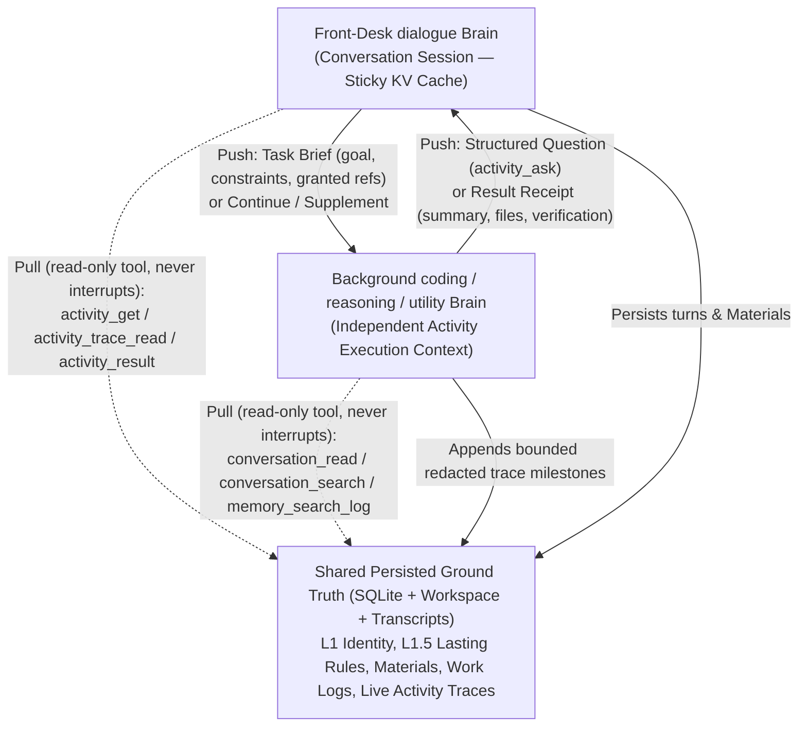

# RFC-0001: Multi-Brain Execution, Direct Data Inspection & Unified Capabilities

- **Status**: `Implemented` (`M0a`–`M4`, including desktop capabilities, Provider routing and execution inspection)
- **Baseline**: `dev` @ `a6d57f8`
- **Reviewers**: Backend Architecture (`t21d`), Deep Technical Review (`t1jr` / Astra-6.2)
- **Canonical Vocabulary**: [docs/design/glossary.md](../design/glossary.md)
- **Promotion Targets**: [product-protocol.md](../design/product-protocol.md), [pi-integration.md](../design/pi-integration.md), [desktop.md](../design/desktop.md), [glossary.md](../design/glossary.md), [README.md](../../README.md)

## Milestone Tracker

- [x] **M0a** — Backend Terminology Sync (`issue_*` → `activity_*`), SQLite v4 `activity_traces`, Direct Read Inspection (`activity_trace_read`, `conversation_read`, `conversation_search`), and Single-JSON `backup` Envelope *(promoted to [product-protocol.md](../design/product-protocol.md) & [glossary.md](../design/glossary.md))*
- [x] **M0b** — Go App (`internal/app/`) `Issue` → `Activity` Symbol Normalization *(promoted to [glossary.md](../design/glossary.md))*
- [x] **M1** — Built-in Tool Presets (`none` / `readonly` / `workspace`) & Text Skills (`SKILL.md`, Global / Workspace / Bot-Authored, progressive L1 catalog, `skill.*` RPCs & Go client, single-JSON `backup.privateSkillBundles`) *(promoted to [product-protocol.md](../design/product-protocol.md) & [glossary.md](../design/glossary.md))*
- [x] **M2** — Multi-Bot Pooled MCP Broker (`shared` / `per_workspace` / `per_bot`) & Private `0600` Credential Vault *(promoted to [product-protocol.md](../design/product-protocol.md) & [glossary.md](../design/glossary.md))*
- [x] **M3** — Executable Skill Sandbox (`scripts/*.mjs`, OS-Enforced Seatbelt Isolation, Inherited-Pipe HTTP Bridge, Content-Addressed Approval) *(promoted to [product-protocol.md](../design/product-protocol.md) & [glossary.md](../design/glossary.md))*
- [x] **M4** — Multi-Provider Pool (`connection.json` v3), Four-Role Invisible Multi-Brain Routing & Side-Effect-Safe Escalation *(promoted to [product-protocol.md](../design/product-protocol.md))*

## Summary & Five Architectural Axioms

1. **Uniform Bot Model**: Every Bot — including built-in `PandoraBox` — runs on the same identity, memory, empty-state, capability, and execution pipeline. Only explicit system capabilities (such as Architect tools) differentiate behavior.
2. **Three-Layer Capability Model**: Every Bot's actionable surface converges cleanly into three layers — **Built-in Tool Presets** (atomic workspace actions), **Executable Skills** (`SKILL.md` + optional OS-sandboxed `scripts/*.mjs`, supporting Bot self-authoring and promotion to global), and **Multi-Bot Pooled MCP** (external stateful connectors). No separate fourth custom-tool system is introduced.
3. **Four-Role Invisible Multi-Brain Execution**: Users configure Providers (not models or thinking levels). Behind the scenes, Xuhu maps cognitive roles (`dialogue`, `coding`, `reasoning`, `utility`) onto the user's configured Provider pool so non-hardcore users can accomplish full conversations and real software engineering purely through natural conversation.
4. **State-First, Read-by-Tool, Never Interrupt-to-Ask**: Models and Bots **never** converse with each other to ask "what are you doing?" or "what did the user say?". Cross-brain and cross-Bot context exchange happens through lightweight structured handoff envelopes (Push) paired with fast, non-disruptive, scope-checked read-only data tools over persisted SQLite/transcript state (Pull).
5. **Unified Cold-Boundary KV-Cache Protection**: Static L0 (`NAGI_BOT_MASTER_TEMPLATE`), alphabetized tool schemas, hot-session model stickiness, and deferred refresh at cold boundaries (idle TTL expiry, cold disk reopen, compaction, new chat, or explicit user rule/capability activation) protect prompt-prefix KV cache across all turns.

## Key Decision Rationale (Why Not Alternatives?)

- **Why State-First Read-by-Tool instead of Agent-to-Agent Chat?** Conversational polling between agents blocks running executions, pays double LLM costs, distorts facts through paraphrasing, and pollutes both KV caches. Reading persisted SQLite traces and bounded Pi transcript projections via deterministic tools is millisecond-fast, zero-LLM-cost, non-disruptive, and model-agnostic.
- **Why Executable Skills (`SKILL.md` + `scripts/*.mjs`) instead of a standalone Custom Tool system?** Standalone Bot-authored atomic tools bloat top-level `tools[]` schemas on every turn, invalidate KV cache on each edit, and separate code from usage guidance. Unifying Bot-authored deterministic scripts into open-standard Skills behind a fixed static tool surface preserves KV cache, binds instructions to code, and stays compatible with the Agent Skills ecosystem.
- **Why OS-Enforced Sandbox + Inherited Pipe instead of Node 22 `--permission` alone?** Node 22.23.5's `--permission` model is documented for trusted code and does not restrict outbound network access. True isolation requires an OS-enforced deny-default sandbox (macOS Seatbelt) applied identically to `skill_test` and `skill_exec`, with mediated outbound HTTP over an inherited pipe so child scripts never touch raw sockets or raw secrets.
- **Why One `.json` Recovery File with Top-Level `backup` Outside `recovery`?** Settings' existing picker and Go installer validate a single `.json` file and rewrite `recovery` with a fresh ID and UI state. Placing `backup` at top level outside `recovery` preserves atomic single-file recovery, keeps normal `contacts.json` mirrors small, and avoids raw SQLite/WAL or split-file installation failure modes.
- **Why Split `M0a` (Backend) from `M0b` (`internal/app` Rename)?** Keeping M0a backend-only prevents write conflicts with concurrent UI work in `internal/app/`, requiring only a coordinated 3-fixture test update on the frozen combined candidate before M0b normalizes Go app symbols.

---

## 1. Terminology Alignment Matrix (M0a / M0b)

All live model tools follow `<domain>_<verb>` (alphabetized, `snake_case` inputs) and JSONL wire RPCs/events follow `<domain>.<verb>` (`camelCase`). No dual live tool aliases are registered. Legacy `issue` tokens remain strictly confined to read-only historical readers (v10 `contacts.json` decoder, retained v1 import metadata, `readImportedActivityResult`, and `xuhu.issue_tools.*` filtering).

| Legacy Name | Unified Target Name | Surface | Compatibility Rule |
| --- | --- | --- | --- |
| `delegate_activity` | `activity_delegate` | Model tool (`product.ts`) | Replace in live bindings; retain persisted `activity.delegate` operation method and delegation key; historical transcripts stay untouched. |
| `issue_list` | `activity_list` | Model tool (`product.ts`) | Replace in live bindings. |
| `issue_get` (`issue_id`) | `activity_get` (`activity_id`) | Model tool (`product.ts`) | Replace tool and parameter name together. |
| `issue_action` (`issue_id`) | `activity_action` (`activity_id`) | Model tool (`product.ts`) | Replace tool and parameter name together. |
| `issue_wait` | `activity_ask` | Model tool (`product.ts`) | Replace live tool name and live `toolFinished` answer-delivery match (`product.ts`); historical `issue_wait` entries never create a live waiter or advance receipts; leave `readImportedActivityResult` historical pairing untouched. |
| `StoredIssue` / `internal/app/issues.go` | `Activity` runtime types & `activity_*.go` | Go app layer (`internal/app/`, M0b) | Keep `StoredIssue` strictly inside `internal/store` v10 JSON decoder; normalize all live Go runtime fields, helpers, and wire bindings to `Activity` in M0b. |
| *(new)* | `activity_trace_read` / `activity.trace` | Model tool + wire RPC (`M0a`) | Bounded, redacted read-only view of live/settled Activity execution trace. |
| *(new)* | `conversation_read`, `conversation_search` | Model tools (`M0a`) | Scope-checked, bounded, credential-independent, model-agnostic read-only lookup over persisted conversation turns and captured Materials. |

## 2. State-First Cross-Brain Context Exchange (M0a)

Different cognitive brains (and different Bots) may run on different model providers with incompatible native reasoning/thinking formats. They never share raw vendor transcripts directly. Instead, they coordinate through a shared persisted ground truth plus lightweight Push/Pull protocols:



### 2.1 Push Envelopes & Admission-Time Authorization

- **Task Brief (`activity_delegate`)**:
  - M0a fields: `key`, `goal`, `assignee_id?`, `requirements?`, `files?`, `linked_activity_ids?`.
  - M4 routing extension fields (deferred to M4 unless explicitly added as inert brief data): `kind` (`"coding" | "research" | "writing" | "ops" | "quick"`), `complexity` (`"light" | "standard" | "deep"`), `constraints?`.
  - **Strict Admission Authorization for `linked_activity_ids` (No Confused-Deputy Escalation)**:
    - Enforce raw input limits before deduplication: at most 32 distinct IDs and 8 KiB serialized total.
    - Before committing the delegated Activity, `product.ts` MUST verify every requested ID against the delegating caller (`originConversationId`, owned by `callerBotId`) using the direct owner/origin predicate (`activity.ownerBotId === callerBotId` OR `conversation(activity.originConversationId).botId === callerBotId`).
    - Self-links, dangling IDs, and transitive re-delegation of another Activity's grant list are strictly rejected.
    - If **any** requested ID is missing or outside `callerBotId`'s direct authority, `activity_delegate` MUST reject the entire call with `scope_denied` (without distinguishing non-existent vs unauthorized IDs to prevent ID-oracle probing) and create zero Activity, receipt, or provider dispatch.
    - Validated, sorted, deduplicated IDs are persisted immutably on the new `Activity` as `grantedLinkedActivityIds` (and captured in the delegation receipt fingerprint; omitted when empty to preserve legacy canonical profile digests). Recovery/import applies the exact same direct-authority predicate before accepting grants from a backup copy.
- **Supplement / Continue (`activity_action` → `add_supplement` / `resume`)**: Current `add_supplement` invokes `continueActivity` on an idle/settled Activity rather than mutating an active in-flight execution; live mid-execution injection is outside M0 acceptance.
- **Blocking Question (`activity_ask`)**: Used only when genuine human judgment is missing from persisted conversation data; the front-desk `dialogue` brain explains trade-offs in plain language and routes the user's answer via `question.answer`.
- **Result Receipt (`Execution` settlement)**: Returns a concise bounded summary, receipt-backed modified/produced file references, and delivery status — keeping verbose coding tool logs out of the front-desk conversation history.

### 2.2 Pull Inspection Contracts (M0a)

Each tool schema uses `Type.Object(..., { additionalProperties: false })`. Model calls bind their identity strictly from the worker-owned `ProductActor` closure (never a caller-supplied actor or Bot ID). Bounds: `limit` 1–50 (default 20), `max_bytes` 2,048–32,768 (default 8,192), `cursor` ≤ 1,024 UTF-8 bytes, `query` 1–256 UTF-8 bytes after trim.

| Surface | Parameters | Result |
| --- | --- | --- |
| `activity_trace_read` / wire `activity.trace` | `activity_id` (`activityId` on wire), `execution_id?`, `cursor?`, `limit?`, `max_bytes?` | `{ items: TraceItem[], nextCursor: string \| null, historyTruncated: boolean, coverage: 'recorded' \| 'unrecorded' \| 'mixed' }`. Each item contains `seq`, `activityId`, `executionId`, `at`, `kind`, and redacted detail fields. Omitted `execution_id` queries across all executions of that Activity. |
| `conversation_read` | `conversation_id`, `cursor?`, `limit?`, `max_bytes?`, `tail?` | `{ items: Turn[], nextCursor: string \| null }`, where `Turn = { messageId, role: 'user' \| 'assistant', timestamp, text, materials: [{ id, name, text, revision, truncated }], truncated }`. Uses captured Material text only (never opens referenced files on disk). |
| `conversation_search` | `conversation_id`, `query`, `cursor?`, `limit?`, `max_bytes?` | `{ items: Hit[], nextCursor: string \| null }`, where `Hit = { messageId, role, timestamp, field: 'text' \| 'material', materialId?, snippet, truncated }`. Literal case-insensitive search (no model-supplied regex) over full authorized redacted public text and captured Material names/text, returning one bounded hit per message in history order. |

### 2.3 Mandatory Read-by-Tool Guardrails

1. **Strict Scope ACL**:
   - Conversation actor → any conversation of its own Bot (submitted turns only, never unsent drafts) and traces for Activities its Bot directly owns or originated.
   - Activity actor → its own `originConversationId` and traces for IDs explicitly recorded in its own immutable `grantedLinkedActivityIds`. `linked_activity_ids` never grant access to linked origin conversations, drafts, other Bots' memory, or mutation methods.
   - Target and `(activityId, executionId)` membership resolve inside this check; missing and unauthorized IDs return uniform `scope_denied` to model callers.
   - Archived Bots have no newly executing actors; existing admitted work may read an archived origin or granted historical target under the same ownership rules without expanding scope. Offline wire reads remain reachable for archived targets.
2. **Opaque Re-Authorized Cursors & Byte-Bounded Scanning**:
   - Cursors encode version, method, target, optional `executionId`, normalized query digest, initial high watermark, scan position, and direction in bounded base64url (zero secrets or text snippets). Every request validates and re-authorizes the cursor; mismatched, malformed, replaced-source, or pruned continuations return `invalid_cursor`.
   - Default forward pages are oldest-first; `tail: true` starts at the newest committed message, returns a chronologically ordered window, and paginates toward older entries (conflicting explicit direction with a cursor is rejected). Retaining the initial high watermark prevents live appends from duplicating or shifting returned items.
   - Byte budgets count the complete encoded JSON response including metadata and `nextCursor`; text/Material excerpts truncate on UTF-8 code-point boundaries while preserving mandatory identifiers (`entry_too_large` if a mandatory identifier cannot fit). Search bounds both output bytes and scanned entries/bytes per call (returning a continuation cursor on scan budget exhaustion).
3. **Credential-Independent Bounded Transcript Reader**:
   - Split the Pi entry reader out of `prepareSession` so read tools inspect live in-memory bindings without starting, refreshing, stopping, or waiting for the session, and read on-disk transcripts without requiring a live provider credential (using canonical regular-file and stored-identity verification from `worker.ts`).
   - An unused binding returns empty history; a used binding whose transcript is missing or unreadable returns `history_unavailable` (distinct from a valid zero-hit search) strictly **after** authorization.
4. **Unified Product Projection Redactor**:
   - One shared redactor runs **before** search matching, excerpt truncation, trace `INSERT`, event emission, and tool output.
   - Draws from the complete inventory of all retained `connection.json` credential source keys (active and saved-but-inactive), live credentials, and M2 MCP vault secrets.
   - Redacts complete known secrets across diagnostic, path, name, and content fields prior to UTF-8 truncation (preventing partial-secret leaks across excerpt boundaries) while keeping structural IDs cleanly typed and uncorrupted.

### 2.4 SQLite v4 Schema & Live Trace Persistence (M0a)

One schema migration after v3 (`product-sqlite.ts`). Because existing primary keys store JSON-encoded strings (`encode(id)`), all foreign-key inserts and predicates bind the exact encoded representation. Because `replaceProfile` deletes and reinserts parent rows on ordinary saves, foreign keys use **`DEFERRABLE INITIALLY DEFERRED` (`NO ACTION`)** — never `ON DELETE CASCADE` and never immediate FKs:

```sql
ALTER TABLE activities ADD COLUMN granted_linked_activity_ids_json TEXT NOT NULL
  DEFAULT '[]' CHECK (json_valid(granted_linked_activity_ids_json) AND json_type(granted_linked_activity_ids_json) = 'array');

CREATE TABLE activity_traces (
  seq INTEGER PRIMARY KEY AUTOINCREMENT,
  activity_id TEXT NOT NULL REFERENCES activities(activity_id) DEFERRABLE INITIALLY DEFERRED,
  execution_id TEXT NOT NULL REFERENCES executions(execution_id) DEFERRABLE INITIALLY DEFERRED,
  at TEXT NOT NULL,
  kind TEXT NOT NULL CHECK (kind IN ('tool_started','tool_finished','file_confirmed','state_changed')),
  detail_json TEXT NOT NULL CHECK (json_valid(detail_json) AND length(CAST(detail_json AS BLOB)) <= 1024)
) STRICT;
CREATE INDEX activity_traces_by_activity ON activity_traces(activity_id, seq);
CREATE INDEX activity_traces_by_execution ON activity_traces(activity_id, execution_id, seq);

CREATE TABLE activity_trace_meta (
  execution_id TEXT PRIMARY KEY REFERENCES executions(execution_id) DEFERRABLE INITIALLY DEFERRED,
  activity_id TEXT NOT NULL REFERENCES activities(activity_id) DEFERRABLE INITIALLY DEFERRED,
  coverage TEXT NOT NULL CHECK (coverage IN ('recorded','unrecorded')),
  evicted_through_seq INTEGER NOT NULL DEFAULT 0
) STRICT;
```

- **Discriminated Detail Schema**: `tool_started` (`tool`, `callId`, `target?`), `tool_finished` (`tool`, `callId`, `ok`, `excerpt?`), `file_confirmed` (`callId`, `path`), `state_changed` (`scope: 'activity' | 'execution'`, `state`). Redacted excerpts cap at 384 UTF-8 bytes and display paths/targets at 256 bytes (marked when shortened); never store raw tool arguments, raw stdout, model reasoning, or full SDK results.
- **Short Transactional Appends**: Tool trace notifications append directly in short SQLite transactions without re-serializing `ProductProfile` or publishing `contacts.json`. Durable state transitions commit alongside their `state_changed` trace row in the same transaction. Emit `activity.traceUpdated { activityId, executionId, lastSeq }` after commit (coalesced before stream `seq` assignment) without incrementing Activity command revision.
- **Retention & Coverage**: Prune oldest rows transactionally on append at 512 rows/execution and 16,384 rows/profile, updating `activity_trace_meta.evicted_through_seq` so `historyTruncated` stays accurate even if all rows for an execution are evicted. Record `coverage = 'recorded'` on new execution admission; pre-v4 / legacy imported executions report `coverage = 'unrecorded'` with empty pages rather than synthesized progress. On explicit snapshot replacement clear prior trace rows; preserve empty-grant omission on legacy canonical serialization so v3 pending-mirror crash repair (`pending_snapshot_previous`) remains intact.

## 3. Four-Role Invisible Multi-Brain Engine & Multi-Provider Pool (M4)

Users never select models or `thinkingLevel` in chat. They configure one or more Provider credentials in Settings and optionally pick one high-level preference (`economy` / `balanced` / `quality`, default `balanced`).

### 3.1 Cognitive Roles

| Role | Primary Workload | Default Thinking | Cache Policy |
| --- | --- | --- | --- |
| `dialogue` | Bot foreground `Conversation` sessions | `off` / `low` | **Session-sticky**: chosen on session creation and locked across hot turns; re-evaluated only at cold boundaries. |
| `coding` | `Activity` with `kind: "coding"` | `medium` (`standard`) / `high` (`deep`) | Fresh Activity context; zero impact on Conversation KV cache. |
| `reasoning` | `Activity` with `kind: "research"` or complex `writing`/`ops` | `medium` / `high` | Fresh Activity context; zero impact on Conversation KV cache. |
| `utility` | Background compaction, consolidation, starter-prompt synthesis, `kind: "quick"` / `complexity: "light"` Activities | `off` | Standalone short context; maximizes cost efficiency. |

### 3.2 Provider Pool, Save/Apply & Revocation Semantics

- **Multi-Provider Accounts & Save/Apply Parity**:
  - Evolve private credential storage (`connection.json` v3, backward-compatible with v2 single connection) to store one or more Provider accounts (`providerId`, `credentialSourceId`, `wireApi`, `baseUrl`, `apiKey`, optional custom model list) while keeping all keys strictly out of `xuhu.db`, `contacts.json`, receipts, and logs.
  - Preserve Xuhu's existing **Save vs Apply** separation ([product-protocol.md](../design/product-protocol.md#methods)) and distinguish three discrete transitions:
    1. **Save (`provider.save` / `provider.delete` / `routing.setPolicy`)**: Updates `savedRevision` only; active routing and open bindings remain untouched.
    2. **Apply (`provider.apply`)**: Promotes `savedRevision` to `effectiveRevision`, updating routing eligibility for future bindings and future cold-boundary re-evaluations (excluded accounts stop receiving new routes; existing cached sessions keep their captured binding while their key remains valid).
    3. **Credential Revocation (`provider.revokeCredential` or key removal on Apply)**: Local revocation gates future dispatch immediately; remote revocation is observed when the provider rejects a request.
- **Automatic Role Assignment**: Combine `/models` discovery (during explicit `provider.test`) with a bundled capability matrix to populate all four role slots automatically. Single-model custom endpoints gracefully collapse all four roles onto that model.
- **Captured Binding Retention & Revoked-Credential Dispatch Behavior**:
  - Every Conversation and Activity captures `(effectiveRevision, providerId, credentialSourceId, resolvedModel, role)` on bind.
  - Offline reads (`conversation.history`, `activity.get`, `activity.result`, `activity.trace`) succeed without a live credential whenever their local data is present (missing external transcripts still yield `history_unavailable`, and unverified imported results may yield `result_unavailable`).
  - **Answering a paused `waitingForAnswer` Activity whose credential is unavailable**:
    - Persist the user's answer and its deterministic operation outcome atomically (`answerSaved: true, delivery: "saved"`, plus typed delivery blocker `credential_unavailable`), so duplicate `operationId` retries return the identical receipt and never redispatch.
    - **Never silently fall back to another Provider mid-session**, and **never resurrect** an execution that became `unknown` / `needsAttention` across restart.
  - **Sending on a bound Conversation whose credential is unavailable**: Keep the unsent `Draft` intact on known non-dispatch (`credential_unavailable`), recording a deterministic rejected/non-dispatched receipt.

### 3.3 Zero-Latency Routing, Cache-Aware Guard & Side-Effect-Safe Escalation

- **Zero-Latency Routing**: Uses zero extra pre-turn LLM classification calls. `dialogue` is sticky for hot conversations; Activities route directly from `(kind, complexity, tool/MCP footprint)` emitted in `activity_delegate`.
- **Cache-Aware Guard**: A hot session never switches models mid-stream while `now - lastTurnAt < providerCacheTtlMs` and cached prefix exceeds threshold.
- **Side-Effect-Safe Automatic Escalation (Authoritative Admission Evidence)**:
  - An MCP server's `readOnlyHint` or a tool's success flag cannot certify replay safety; all unverified tools, product mutations, built-in `write`/`edit`/`bash`, and newly discovered tools default conservatively to `mutating`.
  - Prunable UI `activity_traces` and post-dispatch SDK observer callbacks **never** prove zero admitted mutations. In M4, the runtime records an authoritative pre-dispatch mutation-admission fact (persisted before possible transport dispatch) alongside persistent escalation-budget consumption atomically with the next execution's admission. Missing admission evidence on historical runs disables automatic escalation.
  - Automatic silent escalation is permitted **only when ALL four invariants hold**:
    1. The prior execution has **definitively terminated** (`failed` or `interrupted`, never live or `unknown`);
    2. The authoritative pre-dispatch admission ledger proves **zero `mutating` operations** were admitted or left uncertain (`pending`, `accepted`, or `unknown`);
    3. Escalation budget (`maxEscalations = 1`) has not been consumed;
    4. The original execution remains durably preserved and queryable via `activity.get` and `activity.trace`.
  - Whenever **any** `mutating` operation reached `accepted` or `unknown` (e.g., remote server wrote successfully while response/receipt was lost), automatic silent escalation is **strictly forbidden** and the Activity transitions to `needsAttention` per [product-protocol.md](../design/product-protocol.md#receipts-and-events).

## 4. Three-Layer Unified Capability Architecture

### 4.1 Layer 1 — Built-in Tool Presets (`BotProfile.codingTools`, M1)

Expose all seven pinned Pi coding tools (`read`, `grep`, `find`, `ls`, `edit`, `write`, `bash`) through clean least-privilege presets (with optional advanced per-tool customization in Bot Profile):

| Preset | Effective Built-in Tools | Typical Bots |
| --- | --- | --- |
| `none` | `[]` | Writing, advisor, planning, `PandoraBox` |
| `readonly` | `["find", "grep", "ls", "read"]` | Code reviewer, research analyst, auditor |
| `workspace` | `["bash", "edit", "find", "grep", "ls", "read", "write"]` | Engineering, automation, release Bots |

`PandoraBox` (`bot_create` / `bot_update`) recommends the least-privilege preset matching each new Bot's job instead of defaulting every specialist Bot to full write/bash access.

### 4.2 Layer 2 — Executable Skills (`SKILL.md` in M1 + OS-Sandboxed `scripts/*.mjs` in M3)

Skills unify reusable playbooks and Bot-authored deterministic scripts into one open-standard unit (compatible with `agentskills.io` and `@earendil-works/pi-coding-agent`'s `loadSkills` / `formatSkillsForPrompt`). **Text-only Skills (`M1`) have zero dependency on M3's script sandbox and deliver independently.**

```text
<skill-root>/<skill-name>/
├── SKILL.md            # Frontmatter (name, description) + workflow instructions (M1)
├── manifest.json       # Optional (M3): declared scripts & explicit permission requirements
└── scripts/
    └── *.mjs           # Optional (M3): deterministic ESM scripts run under OS sandbox
```

- **Three Skill Scopes**: Global library (`<appDataDir>/skills/` + optional user-enabled read-only discovery of `~/.agents/skills`), workspace skills (`<workspace>/.agents/skills/`, `<workspace>/.xuhu/skills/`), and Bot-private self-authored skills (`<profile-data>/bots/<botId>/skills/`, with Promote-to-Global in Bot Profile).
- **Static KV-Cache-Safe Tool Surface**: M1 exposes `skill_list`, `skill_read` (works even for `codingTools: []` Bots), `skill_save`, `skill_delete`; M3 adds `skill_test`, `skill_exec`. Only a tiny sorted `<available_skills>` name + one-line description catalog is injected at L1 during session bind/cold refresh; full `SKILL.md` bodies load strictly on demand via `skill_read`.
- **OS-Enforced Script Sandbox (M3 — Identical Boundary for `skill_test` and `skill_exec`)**:
  - Both `skill_test` and `skill_exec` execute the bundled Node 22.23.5 child inside an **OS-enforced deny-default sandbox** (on macOS, Seatbelt enforcing `(deny network*)`, explicitly denying `<appDataDir>`, `connection.json`, `xuhu.db`, `~/.ssh`, `~/.aws`, and system keychains even when a workspace overlaps `<appDataDir>`, permitting reads solely for the bundled Node binary, the immutable staged skill tree, an ephemeral scratch dir, and approved canonical workspace paths), with scrubbed env vars, hard timeout, bounded output, credential redaction, and SIGKILL reaping on cancel or app exit. Node `--permission` is layered solely as secondary defense-in-depth.
  - **Mediated Network Bridge over Inherited Pipe**: Privileged scripts declaring approved outbound origins (`scheme + host + port`) communicate with a worker-owned HTTP broker exclusively over an **inherited request-scoped pipe** (zero direct sockets in the child). The broker enforces exact approved origin (`scheme`, `host`, `port`) and credential binding on every request, disables HTTP redirects initially, injects approved credentials without exposing raw tokens to the script, and caps response bytes. Pre-approval `skill_test` always runs unprivileged.
  - **Fail-Closed Policy**: If the host OS cannot enforce the required filesystem and network isolation, both `skill_test` and `skill_exec` fail closed with `sandbox_unavailable`.
- **Content-Addressed Approval & Immutable Staging (M3 — Zero Post-Approval Swap)**:
  - **Grant Key**: Each approval binds `(principal: ownerBotId / scopeSource, skillId, approvalDigest, reviewedPermissions: canonicalWorkspace + approvedOrigins + credentialRefs)`.
  - **Unambiguous Canonical Digest**: `approvalDigest` hashes the exact staged bytes presented to the user and executed, using unambiguous length-prefixed framing over `{ manifest.json, sorted[(relativePath, byteLength, bytes)] }` while rejecting symlinks and path traversal. The staged execution tree is immutable to both the running script and the authoring Bot.
  - **Invalidation & Re-Confirmation**: Any edit via `skill_save`, disk modification, workspace change, promotion to global, or new credential binding invalidates the prior grant (`approval_required`), even in the same hot session. When restoring a backup onto a **different installation**, imported approvals prove internal consistency only; privileged grants require user re-confirmation unless independently trusted approval provenance exists.
  - **Activation Policy**: Text-only Skills (`M1`) activate immediately for the owning Bot (with 1-click disable/delete); pure-compute scripts (`M3`, zero workspace FS, zero network, zero credentials) auto-activate only under the OS deny-network/deny-FS sandbox after passing `skill_test` bound to that exact `approvalDigest`; privileged scripts require 1-click user approval on a Permission Review Card.

### 4.3 Layer 3 — Multi-Bot Pooled MCP (M2)

1. **Global Server Registry (Settings)**: Configure `stdio` (absolute command, args, env) or Streamable HTTP (URL, headers) once in Settings with explicit **Test & Refresh Tools** caching tool metadata (`name`, `description`, hints). Secret `env` / `headers` live strictly in the private credential vault and feed into both the unified projection redactor and the Memory Exclusion Filter.
2. **Worker-Owned `McpConnectionManager` (Broker & Pooling)**: Lazy-started, ref-counted, idle-reaped pooled connections keyed by `(serverId, scopeKey)` supporting `shared` (stateless API servers), `per_workspace` (canonical `cwd`), and `per_bot` (stateful browser/account instances). App shutdown drains and reaps all pooled MCP child processes cleanly.
3. **Per-Bot Scoped Binding & Handoff Isolation**: Each Bot mounts selected `serverId`s with tool-level filtering (`all`, `readonly`, or allowlist). Delegating an Activity to Bot B applies **Bot B's** MCP bindings (never leaking Bot A's privileges).

## 5. Planned Wire Protocol, Storage & Single-File Backup Contract

### 5.1 Additive Wire Methods & Storage (Within v1)

| Domain | Planned Wire Methods / Events | Persistence & Security Boundary |
| --- | --- | --- |
| Live Activity Trace (`M0a`) | `activity.trace({ activityId, executionId?, cursor?, limit?, maxBytes? })`, event `activity.traceUpdated` | SQLite v4 `activity_traces` + `activity_trace_meta` (bounded, redacted). |
| Tool & Capability Presets (`M1`) | Extended `BotProfile` (`codingTools`, `toolPreset?`, `skillIds?`, `mcpBindings?`) | Stored in `bots.profile_json` (additive optional fields). |
| Skills (`M1` / `M3`) | `skill.list`, `skill.get`, `skill.save`, `skill.delete`, `skill.approve`, `skill.promoteGlobal`, event `skill.changed` | Files under `<appDataDir>/skills/` & `bots/<botId>/skills/` + SQLite binding & `approvalDigest` metadata. |
| MCP (`M2`) | `mcp.list`, `mcp.save`, `mcp.delete`, `mcp.test`, `mcp.status`, event `mcp.changed` | Nonsecret server configs + cached tool catalogs in SQLite `mcp_servers`; secrets strictly in private credential vault. |
| Provider Pool & Routing (`M4`) | `provider.list`, `provider.test`, `provider.save`, `provider.delete`, `provider.apply`, `routing.get`, `routing.setPolicy` (`economy \| balanced \| quality`) | Nonsecret provider metadata & role-slot mapping in SQLite; API keys strictly in private `connection.json` v3. |

### 5.2 Single-File Backup Envelope & Restore Ownership Matrix (`profile.backup`)

To preserve Settings' existing single-JSON picker and captured-byte installer (`internal/app/settings_page.go:546`, `internal/store/store.go:656–939`), `profile.backup` retains **one single `0600` `.json` recovery file** with no raw SQLite/WAL copies or unbound sibling files:

- **Top-Level Shape**: The existing v1 profile (including `recovery: { id, ui }`) plus an optional **backup-only** top-level `backup` object kept **outside `recovery`** (so Go's restore rewrite of `recovery` preserves `backup` verbatim):
  - M0a: `backup: { version: 1, traces: [...], traceCoverage: [...] }`
  - M1/M3: adds versioned `privateSkillBundles` (`ownerBotId`, canonical relative paths, byte lengths, SHA-256, exact bytes with base64 for binary) and `skillApprovals` under explicit bundle/total size limits.
- **Normal Mirror Exclusion**: `snapshotFor` excludes `backup` payload from the normal `contacts.json` mirror. A dedicated backup decoder validates the envelope alongside strict `decodeProductProfile`, extracts `backup` during worker first-open import, atomically commits product records + traces + coverage (and stages immutable private skill generations in M1/M3), then publishes the compact normal mirror via the existing pending-digest crash-repair protocol.

| Data Category | Included in Recovery `.json`? | Restore Behavior in an Independent Directory |
| --- | --- | --- |
| SQLite product state (`bots`, `conversations`, `activities`, `executions`, `operations`, `bot_memory_*`, `grantedLinkedActivityIds`, `recovery.ui`) | **Yes (authoritative)** | Restored atomically after direct-authority & owner-pair validation on readback. |
| `activity_traces` & `activity_trace_meta` (`coverage`, `evictedThroughSeq`) | **Yes (in top-level `backup`)** | Restored with validated `(activityId, executionId)` pairs and quotas; legacy v1/v10 copies without `backup` import `unrecorded` coverage without retaining stale destination rows. |
| Bot-private authored Skills (`bots/<botId>/skills/**`) & `skill_approvals` | **Yes (in top-level `backup` with SHA-256 digests)** | Staged into an immutable generation before committing pointer; digest verified verbatim; privileged grants require re-confirmation when restored onto a different installation. |
| Nonsecret MCP server definitions & Provider pool / routing policy | **Yes (nonsecret only)** | Restored intact; entries whose vault keys are absent surface as `credential_missing` (`credential_unavailable` on dispatch). |
| Private credentials (`connection.json` API keys, MCP secret vault) | **No (strictly excluded)** | Never written into recovery copies; target installation keeps its own private credential store. |
| Global & Workspace Skills (`<appDataDir>/skills/`, `<workspace>/.agents/skills/`) | **External reference only (`skillId`, `source`, optional `expectedDigest`)** | Bot loads normally; missing external skill surfaces non-fatally as `skill_missing`; modified privileged script yields `approval_required`. |
| Pi session transcripts (`sessions/*.jsonl`) & workspace result files | **External reference only** | Unchanged from [product-protocol.md](../design/product-protocol.md#current-profile-admission); missing transcript returns `history_unavailable`; unverified imported results may remain `result_unavailable`. |

## 6. Phased Acceptance Gates

Each milestone ships cleanly behind its own isolated branch/worktree, frozen candidate review, and real built-worker Pi integration tests (including **"create new data → `profile.backup` → restore into an independent directory → second reopen with zero provider calls"**):

| Milestone | Scope & Writer Boundary | Key Acceptance Gates |
| --- | --- | --- |
| **M0a** | Backend-only writer (`internal/pi/worker/`, `internal/pi/`, `internal/store/` recovery adapter, `docs/`). *Requires coordinated QA/app-owner fixture update at `internal/app/{pi_delegation,pi_app,pi_product_ui}_integration_test.go` on the combined frozen candidate.* | Live concurrent trace reads during active Activity; Activity reading live & cold-no-credential `originConversationId` without waking Conversation; **confused-deputy & non-transitivity** (A → B with unauthorized C returns `scope_denied` with zero Activity/receipt/dispatch, valid A → B grant blocks onward access to C); unrelated profile saves keep traces intact (`DEFERRABLE` FKs); v3 pending-publication mirror repair migration; redaction of saved-but-inactive keys across excerpt boundaries; single-JSON `profile.backup` → independent-directory restore + reopen with zero provider calls + v1/v10 compatibility. |
| **M0b** | Frontend/app writer (`internal/app/`, plus `internal/store/tool_contract.go` caller audit; retain legacy `StoredIssue` JSON admission). | Full headless + Pi integration + native compile green with zero live `Issue` terminology outside legacy v10 store decoders. |
| **M1** | Tool presets + text `SKILL.md` (Global / Workspace / Bot-private). Zero executable script dependency. | Zero L0 mutation, `codingTools: []` Bots reading mounted skills via `skill_read`, private skill isolation, cold-boundary L1 refresh, independent-directory restore (`skill_missing` for missing external skills). |
| **M2** | Multi-Bot pooled MCP broker + private MCP vault. | Mock stdio/HTTP MCP servers prove connection pooling, workspace isolation, per-Bot allowlists, secret redaction/exclusion, zero orphan processes on exit, independent-directory restore (`credential_missing`). |
| **M3** | OS-enforced script sandbox + inherited-pipe HTTP broker + content-addressed approval. | `connection.json`, `xuhu.db`, overlapping workspace, and outbound sockets denied in BOTH `skill_test` and `skill_exec`; timeout SIGKILL & app-exit reaping; **no post-approval swap** (approve A → `skill_save` B → hot-session `skill_exec` returns `approval_required` with zero execution of B); restore to independent installation preserves private scripts + digests and requires privileged re-confirmation. |
| **M4** | Multi-Provider pool (`connection.json` v3) + four-role invisible multi-brain routing + side-effect-safe escalation. | Hot Conversation stickiness & Activity routing by `kind + complexity`; **zero duplicate side effect on lost receipt** (server write succeeds + receipt dropped → final write count == `1`, zero silent escalation, `needsAttention`, original execution queryable); **deleted-Provider resume** (`waitingForAnswer` → delete Provider & Apply → restart → answer → `delivery: "saved"` + `credential_unavailable`, duplicate `operationId` identical, zero silent cross-provider fallback, zero resurrection of `unknown` runs); independent-directory restore (`credential_missing`). |
