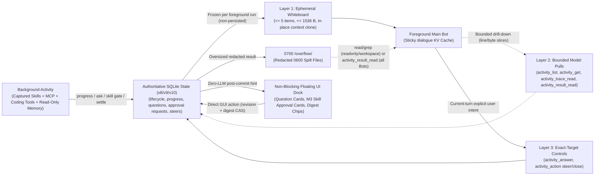

# RFC-0002: Bot-Activity Control Plane v2 (Bounded Peripheral Awareness, Typed Question Triage, Live Steering & Capability Parity)

- **Status**: `Implemented` (`CP-1`–`CP-3` in the worker and desktop Workbench)
- **Baseline**: `dev` @ `60c8f6f` (all RFC-0001 backend milestones `M0a`–`M4` merged; pinned Pi SDK `1.5.2`)
- **Reviewers**: Backend Architecture (`t21d`), Deep Technical Review (`t1jr` / Astra-6.2, including offline Pi `1.5.2` `ExtensionRunner` probe)
- **Canonical Vocabulary**: [docs/design/glossary.md](../design/glossary.md)
- **Promotion Targets**: [product-protocol.md](../design/product-protocol.md), [glossary.md](../design/glossary.md), [desktop.md](../design/desktop.md), [README.md](../../README.md)

## Milestone Tracker

- [x] **CP-1** *(SQLite v8)* — Activity capability parity, execution traces, bounded inspection and result reads, progress, explicit acknowledgment and closure, and dedicated skill approval.
- [x] **CP-2** *(SQLite v9)* — Ephemeral whiteboard, authoritative reconstruction of digest notices, structured questions, and typed preference triage.
- [x] **CP-3** *(SQLite v10)* — Durable mid-execution steering with delivery receipts and no-replay recovery.

---

## Problem Statement: "Neither Too Much Nor Too Little"

RFC-0001 (`M0a`–`M4`) delivered a robust execution and isolation foundation: independent `Conversation` and `Activity` contexts, direct-owner `grantedLinkedActivityIds`, SQLite v4–v7 durable traces and pre-dispatch mutation admissions, pooled MCP, OS-sandboxed executable skills, and four-role multi-brain routing.

A source audit of `internal/pi/worker/{product.ts,worker.ts,protocol.ts,product-sqlite.ts,bot-template.ts}` exposes six control-plane gaps between the foreground **Main Bot (`Conversation`)** and background **Activities**:

1. **Foreground Blindness**: When an Activity completes, fails, or suspends on `activity_ask` (`product.ts:1513-1537`, `2298-2321`), only a UI `activity.changed` event fires. Main Bot has zero awareness on subsequent user turns unless the user asks and the model proactively calls `activity_list`.
2. **All Questions Interrupt & Lack Structured Choices**: `activity_ask` (`product.ts:2096`) accepts only raw text `{ text: string }`, cannot resolve already user-approved routine preferences silently, and cannot express structured selectable options (`options[]`) for non-blocking floating UI cards.
3. **No Mid-Execution Live Steering**: While an Activity is live, `continueActivity`/`add_supplement` returns `busy` (`product.ts:1761`). Adjusting a running multi-minute task forces a hard `stop` and restart even though pinned Pi SDK `1.5.2` exposes `session.steer()`.
4. **Collapsed Terminal Lifecycle**: Every settled Activity unconditionally becomes `needsAttention` (`product.ts:1515`), even though `protocol.ts:136-139` already defines `completed` and `cancelled`. Finished work piles up with no acknowledgement or closure model.
5. **Capability Asymmetry on Background Activities**: `prepareSession` (`product.ts:1305,1330-1334`) and `tools()` (`product.ts:2095-2144`) attach L1.5 `Lasting Rules`, `<available_skills>`, `skill_*`, and `memory_*` **only to `Conversation` bindings**, stripping background Activities of the Bot's mounted Skills and work-log search. Additionally, `runSkill`/`approveSkill` read the mutable current profile workspace rather than the execution's captured canonical `cwd`.
6. **Unbounded Model Inspection & Missing Orchestration Discipline**: Model `activity_list` emits **all** visible Activities (`product.ts:2115`), `activity_get` emits up to 512 KiB of live partials plus full Materials, questions, executions, and unclipped `results` (`product.ts:559-590,2121`), Activities lack semantic progress reporting, and `NAGI_BOT_MASTER_TEMPLATE` (`bot-template.ts:7-12`) gives zero guidance on direct reply vs delegation.

This RFC specifies **Bot-Activity Control Plane v2**, balancing foreground context hygiene against timely operational visibility while preserving Nagi's strict authorization, no-replay, redaction, and wire-v1 invariants.

---

## Five Control-Plane Axioms

1. **Ephemeral, In-Place Peripheral Awareness (Zero History Bloat, Stable Pre-Insertion Prefix)**: Main Bot observes active/pending work through a single redacted, byte-bounded `<active_activities>` snapshot frozen per foreground execution and edited **in place** onto the SDK-cloned current-run user message via Pi `1.5.2`'s `context` hook—never persisted into Pi session JSONL or `nagi-turn-v1` and never replacing visible message objects.
2. **Zero-LLM-Cost Digest UI Hints (Superseded Passive Global Rule)**: `activity.digest` emits structured post-commit UI status-chip hints without directly submitting a model request (receiving or reconstructing a UI hint never prompts Main Bot directly). Note: this no longer implies Main Bot must stay passive while the user is away—under [RFC-0004](0004-stateful-sessions-and-autonomous-orchestration.md), an independently authorized watch may consume the same durable SQLite Activity transition atomically in the producer transaction to schedule a private autonomous orchestration turn.
3. **Authorization Survives Model Error**: Model confidence never grants permission. Silent resolution of `activity_ask` is restricted exclusively to backend-verified, typed, low-risk preferences backed by explicit user-approved durable evidence records; every free-form question, open tradeoff, permission request, external side effect, or uncertain case fails closed to a non-blocking floating human card. Privileged M3 skill execution uses a dedicated GUI-only approval request that text questions and triage can never create or approve.
4. **Separate Admission, Consumption, Disposal & No-Replay Proofs**: Live steering persists pre-dispatch intent, admits only actively streaming executions, proves consumption from Pi's user-role message stream, requires positive disposal proof for `not_applied`, preserves `unknown` across crashes with zero replay, and disables automatic M4 escalation on any steered execution.
5. **No Recursive Sub-Activities & Spill-on-Overflow Inspection**: Only foreground `Conversation` actors and authorized Main-Bot `OrchestrationActor` runs under [RFC-0004](0004-stateful-sessions-and-autonomous-orchestration.md) (preserving a real `originConversationId` and distinct provenance) delegate Activities (zero Activity-to-Activity recursion). Every model inspection DTO is strictly byte-bounded after redaction/escaping; oversized results spill post-redaction to `0600` files under `0700` `<stateDir>/overflow/` (`overflowPath`) paired with a universal scoped line/byte reader (`activity_result_read`) accessible even to `toolPreset: "none"` Bots.

## Key Decision Rationale (Why Not Alternatives?)

- **Why In-Place Clone Editing in Pi's `context` Hook Instead of Object Replacement or Persisted Prompt Suffixes?**
  - An offline probe of pinned Pi SDK `1.5.2` (`extensions/runner.js:90-105,1014-1030`) proved that replacing even one visible message object or appending a synthetic message causes `restoreSystemMessages` to collapse mid-history system messages into a single leading system message, altering the start of the provider request. Editing the current-run user message's content **in place** on the SDK-provided deep clone preserves exact mid-history system positions and leaves stored session transcripts byte-identical.
- **Why Backend-Verified Typed Preference Resolution Instead of Free-Form LLM Auto-Approval?**
  - Allowing an LLM triage pass to self-certify `confidence: "high"`, `reversible: true`, and emit arbitrary text back into a suspended `activity_ask` tool call lets untrusted workspace/MCP content prompt-inject an Activity into authorizing privileged downstream actions. Restricting silent resolution strictly to backend-constructed answers derived from explicitly user-approved durable evidence records (with provenance `bot_auto` exposed on both tool result and receipt) ensures authorization survives model error.
- **Why Spill-to-File (`overflowPath`) + Universal Line/Byte `activity_result_read`?**
  - Spilling oversized redacted payloads to worker-owned `0600` files matches Pi's mature truncation pattern so `readonly`/`workspace` Bots can use `read(path, offset, limit)` or `grep` naturally. Pairing that with a scoped, ACL-checked `activity_result_read` supporting both 1-indexed line ranges (`start_line`/`end_line`) and UTF-8 byte/cursor slices guarantees `toolPreset: "none"` (`codingTools: []`) Bots can read large results without gaining arbitrary filesystem read access.
- **Why Keep 6 Wire-v1 `Activity.state` Literals, 4 `activity_traces` Kinds, and Successive SQLite Migrations (`v8`/`v9`/`v10`)?**
  - Protocol v1 (`product-protocol.md`) allows additive optional fields while discouraging incompatible enum mutations; `completed` and `cancelled` already exist in `protocol.ts:136-139`, and `closedAt` cleanly represents archival closure without a 7th state literal. Keeping the 4 existing trace kinds avoids rebuilding `activity_traces` and preserves backup/cursor compatibility. Successive immutable migrations (`v8` for CP-1, `v9` for CP-2, `v10` for CP-3) guarantee already-upgraded installations never skip later schema additions.

---

## 1. Three-Layer Progressive Information Funnel



### 1.1 Layer 1 — Ephemeral `<active_activities>` Whiteboard (CP-2)

- **Bot-Wide Scope**: Matches existing `visibleActivities`/`scopedActivity` ownership (`ownerBotId === botId` OR `originBotId === botId` across conversations, `product.ts:594-597,1660-1675`) so starting a new chat never hides handed-off work. UI digest chips and floating cards still route strictly to their stable `originConversationId`.
- **Eligible States & Deterministic Ranking**:
  1. `waitingForAnswer` or pending M3 skill approval request (highest priority)
  2. `needsAttention` (`failed`, `interrupted`, `unknown`, mutation-blocked escalation)
  3. `running` (active executions)
  4. `completed` with `acknowledgedAt == null` and `closedAt == null`
  - Tie-break deterministically by persisted update timestamp descending, then stable `activityId` ascending.
  - Activities with non-null `closedAt` or `completed` with non-null `acknowledgedAt` are excluded.
- **Exact Pi `1.5.2` Projection Mechanics**:
  - Capture **one immutable, redacted, escaped snapshot per foreground `Conversation` execution** at user-send admission, using absolute timestamps (or frozen relative ages) so every internal multi-tool LLM call inside that run shares the identical decorated user message.
  - Register a Nagi `context` extension handler **only on foreground `Conversation` sessions** (never on Activities, triage calls, provider tests, or raw contexts).
  - Identify the current-run user message strictly by runtime-owned turn identity/index with validation (never string-matching repeated user text).
  - **Edit that cloned user message's content array/text IN PLACE** on the SDK-provided clone (preserving object identity, array order, images, quote/Material blocks, and tool-result roles; never replacing the message object or inserting synthetic messages).
  - If compaction or another projection removes the validated anchor, omit the board for the remainder of that execution. If the board is empty or unreadable, return `messages` untouched. Clear the captured snapshot on settlement, abort, or reopen.
- **Honest Cache Contract**:
  - Guarantees **byte-identical provider prefix strictly before the current-run insertion**, single frozen prefix across multi-tool iterations within one foreground turn, and **zero board bytes persisted** in session JSONL, `nagi-turn-v1`, or public history.
  - Explicitly does **not** claim cross-turn provider cache hits past a prior turn's omitted board (since removing turn `N-1`'s ephemeral board alters bytes at turn `N-1` on turn `N`); provider cache retention remains vendor-controlled.
- **Hard Post-Escaping Budgets**:
  - `MAX_WHITEBOARD_ITEMS = 5`; `MAX_WHITEBOARD_BYTES = 1536` UTF-8 bytes computed **after** unified redaction, newline normalization, and XML escaping, inclusive of wrapper tags and overflow line (`(+N more active/unread activities; call activity_list)`).
  - Exact IDs (`activityId`, `executionId`, `questionId`, `requestId`) are never truncated; if a row's mandatory IDs cannot fit within the remaining budget, omit the row and increment the overflow count.
  - Frame the block explicitly as untrusted presentation telemetry (a model-authored `stage`, `goal`, or `recommended` label carries zero command authority).

### 1.2 Layer 2 — Fully Bounded Inspection Surface, Spill-to-File (`overflowPath`) & Universal Line/Byte Slicing (CP-1)

Every model-facing inspection surface uses **separate bounded model DTOs** while preserving exact existing Go/UI `activity.get` and `activity.result` wire contracts:

1. **Bounded Model `activity_list({ states?, cursor?, limit?, max_bytes? })`**:
   - Replaces current unbounded `visibleActivities` dump (`product.ts:2115`) with paginated, redacted, byte-bounded summaries (`limit` 1–50 default 20, `max_bytes` 2048–32768 default 8192, opaque re-authorized cursor via `product-inspection.ts`).
2. **Bounded Model `activity_get({ activity_id, max_bytes? })`**:
   - Enforces full JSON/UTF-8 byte budget (`default 8192`, `range 2048..32768`) **after** redaction and escaping across ALL variable fields (`partial`, `materials`, `questions`, `approvalRequests`, `executions`, `results`).
   - Returns bounded previews (`textExcerpt`, `totalBytes`, `totalLines`, `truncated`, confirmed `files[]` page) plus an explicit overflow pointer whenever a settled execution result (or large live partial) exceeds the inline preview threshold.
3. **Spill-to-File (`overflowPath`) + Universal Scoped Reader (`activity_result_read`)**:
   - **Redacted Ephemeral Spill Artifact**: When a settled Activity result exceeds the inline preview budget (default `8192` UTF-8 bytes), the worker writes the **already redacted** UTF-8 result text atomically into a worker-owned `0700` directory (`<stateDir>/overflow/<executionId>-result.txt`, mode `0600`, reaped on TTL and app shutdown, excluded from `contacts.json` mirror and single-file backups).
   - `activity_get` returns `{ overflowPath, totalLines, totalBytes, truncated: true, preview }` (for Bots with `readonly` or `workspace` coding tools, `overflowPath` can be read/searched directly with Pi's built-in `read(path, offset, limit)` or `grep`; for `toolPreset: "none"` Bots, `overflowPath` may be omitted or paired with the universal reader hint so the model immediately uses `activity_result_read`).
   - **Universal Scoped Line/Byte Reader `activity_result_read`**:
     - Available to **ALL** authorized Conversation and Activity actors—including `toolPreset: "none"` (`codingTools: []`) Bots without granting arbitrary filesystem read access.
     - Parameters (`additionalProperties: false`): `{ activity_id, execution_id, start_line?, end_line?, byte_offset?, cursor?, max_bytes? }` (`start_line`/`end_line` 1-indexed inclusive; mutually exclusive with `byte_offset`/`cursor`; `max_bytes` 2048–32768 default 8192).
     - Reads the exact settled redacted result (supporting imported transcript results or returning their existing typed `result_unavailable` error strictly after ACL authorization) and confirmed file references.
     - Opaque cursor binds `(version, method, activityId, executionId, sourceGeneration, contentDigest, position)` and re-authorizes on every call; invalidates cleanly on source replacement (`invalid_cursor`), never splits UTF-8 code points or skips/repeats bytes, guarantees cursor advancement, and returns `entry_too_large` only if mandatory identity fields cannot fit.
     - Activity-side ACL: limited strictly to immutable `grantedLinkedActivityIds` (read-only; never permits `answer`, `steer`, or `close` on a linked Activity).
4. **Replay-Safe `activity_progress({ stage, step?, total_steps? })`**:
   - Parameters: `stage` (`1..160` UTF-8 bytes, non-blank), optional `step` (`1..1000`), optional `total_steps` (`1..1000`, `>= step`).
   - Classified **`readonly`** in M4's `execution_mutation_admissions` allowlist.
   - Bound to `(activityId, executionId, callId)`, deduplicated, reset atomically when a new execution starts, and excluded from authorization/approval logic.
   - Stored in a compact auxiliary SQLite table (`activity_progress`) with a monotonic `progressSeq` **independent of Activity command CAS `revision`** and rate-limited (e.g., max 1 persisted emission per 2s unless `step` changes) BEFORE persistence/emission—preventing full `contacts.json` mirror rewrites on every step and avoiding stale user command revisions (UI refreshes via `progressSeq` / trace event rather than dropping equal command revisions).
   - Recorded in `activity_traces` strictly through the existing `tool_finished` trace kind (bounded redacted excerpt), keeping the 4 v1 trace kinds unchanged.

### 1.3 Layer 3 — Zero-LLM Digest Hints & Reconnect Reconstruction (CP-2)

- Emit post-commit hint event `activity.digest` (`{ factId, activityId, ownerBotId, originConversationId, executionId?, revision, kind: 'completed' | 'needs_attention' | 'question_open' | 'question_auto_saved' | 'approval_required', summary, fileCount?, questionId?, requestId?, at }`).
- **Hint, Not Source of Truth**: Digests stay outside composer drafts and Pi transcripts. The Workbench reconstructs notices from `activity.list` and `activity.get`, including unacknowledged completed work alongside `running`, `waitingForAnswer`, and `needsAttention`.
- Late `question_open` or `approval_required` events never reopen an already answered/resolved card; a failed utility execution superseded by an admitted M4 escalation renders as superseded.

---

## 2. Typed Question Triage, Floating Cards & Forwarding Authority (CP-2)

### 2.1 Upgraded `activity_ask` & `ProductQuestion` Schema (Additive Within v1)

```ts
activity_ask({
  text: string,                        // 1..1024 UTF-8 bytes (existing single-field calls remain valid)
  options?: Array<{                    // optional, max 6 items, unique slug IDs, <= 1 recommended
    id: string,                        // ^[a-z0-9][a-z0-9_-]{0,63}$
    label: string,                     // 1..120 UTF-8 bytes
    description?: string,              // optional <= 256 UTF-8 bytes
    recommended?: boolean,
  }>,
  allow_free_text?: boolean,           // default true; if false, options MUST be non-empty
  requires_user_decision?: boolean,    // default false; true always bypasses Tier 1
  preference_key?: string,             // optional product-owned typed preference domain key for Tier-1 lookup
})
```

- When `allow_free_text === false`, `options` must contain at least 1 item, user/Bot answers must supply a valid `selectedOptionId`, and the backend derives the canonical answer text from the declared option label so ID and text can never disagree. When `allow_free_text === true` and `selectedOptionId` is supplied, validate the ID against declared options.
- Expose provenance (`provenance: 'user' | 'bot_auto'`, plus optional `evidenceId`, `evidenceRevision`, `selectedOptionId`) in BOTH the `activity_ask` tool return AND the durable `ProductQuestion` receipt.

### 2.2 Authorization-Safe Two-Tier Resolution (Resolving P0 Authority Blocker)

1. **Pre-Triage Reservation (Zero Race Window)**:
   - Immediately persist the question row keyed by `(activityId, executionId, callId)` in phase `triage_pending` (or `open` if bypassing Tier 1), install a cancellable waiter, and capture the current owning Bot's `rulesRevision` / evidence revision BEFORE any async read or inference.
2. **Strict Tier-1 Eligibility (Backend-Verified Preference Evidence ONLY)**:
   - Silent auto-resolution is permitted **ONLY** for a **product-owned, typed, low-risk preference** (`preference_key` in a narrow backend allowlist—e.g. formatting, language, naming convention, test-runner choice—NEVER permissions, destructive/external side effects, credential entry, open design tradeoffs, or free-form questions) backed by an **explicitly user-approved durable evidence record** in the correct scope (e.g., an explicit `bot_memory_rules` entry with verified `ruleId` and `rulesRevision`).
   - **Model Cannot Mint Authority**:
     - Deterministic local matching runs first where unambiguous.
     - If an optional bounded, tool-less side-channel model pass is used to map `preference_key` + question against the owning Bot's approved rules, that model may **ONLY nominate an existing `evidenceId` (and optional matching declared `optionId`) or decline (`escalate_user`)**. It can **NEVER** assign risk class, fabricate evidence, invent arbitrary answer text, or elevate tool authority.
     - The backend constructs the canonical answer strictly from the verified durable evidence record (and matching declared option if applicable), tagging `provenance: 'bot_auto'`.
   - **Data Destination & Fetch Guard**:
     - Send only owner-scoped approved rule records and minimal question metadata (omit Materials, quotes, and unrelated private history by default).
     - Never transmit composite cross-Bot data to a different Provider endpoint unless covered by the product's approved routing/data policy; otherwise stay local or escalate to Tier 2.
     - Install the captured credential/revocation fetch guard explicitly on tool-less triage calls (fixing `worker.ts:345-357` which currently attaches it only when `productTools.length > 0`), set both built-in and custom tools empty, write zero Pi JSONL/work logs/extensions, and enforce a hard `15s` timeout + `512`-token cap. Count triage calls separately from zero-LLM digest guarantees.
3. **Durable Attempt Budget, CAS Commit & Separate `saved` → `delivered` Pipeline**:
   - Charge `triageAttemptsUsed` durably **before** dispatch (lifetime cap per Activity, e.g., `MAX_TRIAGE_ATTEMPTS = 3`, `MAX_AUTO_ANSWERS = 2`, max 1 in-flight attempt per question, bounded worker concurrency, zero retries, real abort on stop/shutdown).
   - Commit the nominated auto-answer via SQLite CAS verifying `(question phase === 'triage_pending', question revision unchanged, execution still live with zero stop intent, credential valid, evidence revision unchanged, attempt/auto-answer budgets valid)`.
   - Any newly submitted user turn mutating that evidence invalidates the proposal; an explicit human answer wins before auto-commit; stop/shutdown/settlement cancels triage and prevents a phantom live card; worker loss preserves the question/evidence and surfaces execution uncertainty without rerunning triage or fabricating a waiter.
   - Commit follows the exact existing delivery pipeline: `saved` → `dispatching` (immediately before resolving the exact waiter) → `delivered` ONLY on matching successful `activity_ask` tool-end (`saved` + `credential_unavailable` if revoked; `unknown` on crash during `dispatching`). `activity.digest` emits `question_auto_saved` (never claiming delivered before observed).
4. **Tier-2 Non-Blocking Floating User Card & Guaranteed Foreground Capacity**:
   - Every ineligible, free-form, high-risk, open-tradeoff, conflicting-evidence, cap-exhausted, or failed-triage question enters `waitingForAnswer` with its structured `options[]` and `allowFreeText` for a non-blocking floating card above the composer.
   - **Capacity Saturation Fix (`product.ts:1172-1175,1391-1394`)**: Currently `capacity()` counts `active.size` (default `2`), and `waitingForAnswer` Activities remain in `active`, allowing 2 waiting Activities to block ordinary foreground chat even though the UI is non-modal. CP-2 **reserves foreground `Conversation` dispatch capacity separately from parked `waitingForAnswer` / `approval_pending` Activities**, keeping parked executions cancellable and scheduling resumes under explicit bounded provider concurrency so configured concurrency is never exceeded silently (verified even when `maxActiveTasks = 1`).
5. **Foreground User-Turn `activity_answer` Authority & Target Discipline**:
   - Keep the advertised tool schema static (`activity_answer`, `activity_action`).
   - Require exact observed `(activity_id, execution_id, question_id, question_revision)` (and optional `selected_option_id`)—never silently looking up "latest revision" to make a stale model call succeed. Derive idempotent `operationId` from the issuing `(conversationExecutionId, callId)`.
   - Apply strict direct owner/origin ACL.
   - **Current-User-Turn Evidence Requirement (Foreground Relay)**: A foreground model tool call alone does not prove the user answered (untrusted whiteboard text, quotes, Materials, or tool outputs must never trigger unauthorized answers). Direct commit on this user-turn relay path is allowed when bound to a clear, unambiguous reply in the **current admitted user turn** targeting that exact question; otherwise return a non-blocking proposed-answer confirmation to the user rather than mutating the Activity silently. Future autonomous continuation/coordination by a private orchestration actor follows the separate mandate-bound contract defined in [RFC-0004](0004-stateful-sessions-and-autonomous-orchestration.md).

---

## 3. Durable Mid-Execution Live Steering (CP-3)

### 3.1 Exact-Target RPC & Tool Surface

- **Wire RPC**: `activity.steer({ activityId, executionId, expectedRevision?, operationId, text, materials })` → returns durable steer receipt `{ operationId, steerId, activityId, executionId, state: 'pending_enqueue' | 'queued' | 'delivered' | 'not_applied' | 'unknown' | 'rejected', revision, reason? }`.
- **Readback & Event**: `activity.steerStatus({ operationId | steerId })` (or via `operation.get` + `activity.get`) and revisioned `activity.changed` notification distinguishing immutable original command reply from live delivery state.
- **Model Tool**: Extend `activity_action` with `steer` requiring exact `(activity_id, execution_id, text)`, bound to the current admitted user turn's text/Materials and deriving idempotent `operationId` from `(conversationExecutionId, callId)`. Calling `steer` on an idle Activity fails explicitly with `not_running`. Scheduled or autonomous Main-Bot steering without a user turn uses the separate mandate-bound `OrchestrationActor` operation specified in [RFC-0004](0004-stateful-sessions-and-autonomous-orchestration.md) with distinct actor provenance and the same consumption/no-replay proofs, never spoofing a foreground user turn.

### 3.2 Admission, Non-Slash Envelope, Consumption Proof & Disposal

1. **Serialized Streaming-Only Admission**:
   - Persist a `pending_enqueue` row in SQLite v10 `activity_steers` (`steer_id PK`, `activity_id`, `execution_id`, `operation_id UNIQUE`, `fingerprint`, `payload_json`, `state`, `created_at`, `settled_at`; `DEFERRABLE INITIALLY DEFERRED` FKs) BEFORE calling Pi SDK. Deduplicate by `operationId` + target + input fingerprint (`operation_conflict` on mismatch).
   - Admit ONLY when the exact `(activityId, executionId)` is actively streaming in the worker with valid captured credential and ZERO pending stop, settlement, triage, open human waiter, or pending skill approval request. Serialize enqueue and lifecycle transitions per execution; track in-flight enqueues and prevent session reuse until reconciled or disposed.
2. **Canonical Non-Slash Envelope & Input-Hook Control**:
   - Wrap redacted steer text + bounded captured Materials in a canonical non-slash envelope containing a worker-generated `steerId` and SHA-256 payload digest (`<activity_steer id="..." digest="...">...</activity_steer>`) so leading `/` text never triggers Pi slash/skill/extension command parsing (`agent-session.d.ts:591`), and ensure no custom input hook intercepts or transforms worker steers (`handled` disposition rejected cleanly as non-enqueued).
   - Commit `queued` only on observed enqueue without overwriting a faster terminal state (`delivered` / `not_applied` / `unknown`).
3. **Positive Consumption & Disposal Proofs**:
   - **`delivered`**: Observed ONLY when Pi emits user-role `message_start` / `message_end` (`pi-agent-core/dist/agent-loop.js:120-146`) on that exact live `(contextId, executionId)` matching the pending steer's exact `steerId` and payload digest (ignoring assistant/tool echoes and generic assistant turn starts; concurrent steers correlated in admission order). Note: Pi steers follow the **entire current assistant tool batch** and cannot cancel already-admitted tools. Crash between observation and SQLite commit stays `unknown`.
   - **`not_applied`**: Reported ONLY on proved non-enqueue OR positive removal of the exact pending entry from an exclusively owned quiet Activity session (`clearQueue()` reconciliation after run/enqueue quiescence, or clean session disposal before reuse—noting `abort()` does NOT clear Pi queues, `agent-session.js:2046-2084`). Missing observation alone NEVER qualifies as `not_applied`—it remains `unknown` with zero automatic re-enqueue across stop, crash, or restore.
4. **M4 Escalation Interaction**:
   - **Disable automatic M4 escalation for any execution with an admitted steer** (enforced in both `ProductSQLite.canEscalate` AND the replacement-admission transaction). Because M4 re-runs `prior.input` on a fresh binding, silently escalating a steered run would drop the user's mid-run correction; explicit `activity.continue` remains available instead.

---

## 4. Activity Capability Parity, Captured `cwd` & Dedicated Skill Approval Card (CP-1)

### 4.1 Captured Binding Parity & Governance Fence

- **New on Activity Bindings (`product.ts:1305,1330-1334`)**: Capture the receiving Bot's (`activity.ownerBotId`) L1.5 `Lasting Rules`, `<available_skills>` catalog, identity, instructions, and **canonical `cwd`** at Activity binding time (retaining captured identity, instructions, and `cwd` verbatim across resumes).
- **Thread Engine-Owned Captured `cwd`**: Pass `(actor, executionId, capturedCwd)` strictly into `skill_list`, `skill_read`, `skill_test`, `skill_exec`, and `skill.approve` (fixing `product.ts:1930-1943,1959-1998,2054-2089` where `runSkill`/`approveSkill` read the mutable current profile workspace and allowed omitting `permissionsDigest`). Re-verify active owner, mount, staged bundle digest, permissions digest, credential binding, installation ID, and cancellation at every invocation.
- **Structured Error Adapter**: Wrap Activity tool executions in the same `RequestError` projection adapter used for `Conversation` tools (`product.ts:2145-2151`). Keep `skill_test` conservatively `mutating` in M4's admission ledger (a successful pure-compute test persists pure activation).
- **Strict Capability Table**:
  - **Granted to `Activity`**: `<available_skills>`, `skill_list`, `skill_read`, `skill_test`, `skill_exec`, read-only `memory_search_log` (scoped strictly to `activity.ownerBotId`), `activity_progress`, `activity_ask`, plus existing M0a inspection (`activity_trace_read`, `conversation_read`, `conversation_search`, `activity_result_read` scoped strictly to `originConversationId` and immutable `grantedLinkedActivityIds`).
  - **Denied to `Activity`**: `skill_save`, `skill_delete`, `memory_save_rule`, `memory_forget_rule`, `memory_propose_learning`, `memory_log_work`, `activity_delegate` (no recursion), `activity_answer`, `activity_action`, `bot_*` Architect tools.
- **Conditional Static L0 Orchestration Guidance (`bot-template.ts`)**:
  - Preserve the exact first line of `NAGI_BOT_MASTER_TEMPLATE` (`isNagiBotSystemPrompt` anchor).
  - Keep orchestration lines conditional on available actor/tools (foreground `Conversation` gets concise guidance on direct chat vs `activity_delegate(kind/complexity/constraints)`, consulting `<active_activities>` / bounded inspection tools, and unambiguous `activity_answer`; background `Activity` never receives delegation or answering instructions; private autonomous `OrchestrationActor` runs under [RFC-0004](0004-stateful-sessions-and-autonomous-orchestration.md) receive dedicated orchestration guidance without foreground user-speech rules). Existing captured L0+L1 prefixes remain verbatim on cold reload (`lessons.md`).

### 4.2 Dedicated M3 Skill Approval Request Card (Separate from Text `activity_ask`)

- When a background Activity invokes `skill_exec` and M3's trusted pre-spawn gate (`skill-sandbox.ts:193-202`) determines `approval_required`:
  - The trusted handler—NOT the model—persists a typed `skill_approval_requests` row (`requestId`, `botId`, `activityId`, `executionId`, `callId`, `source`, `skillId`, `script`, `approvalDigest`, `permissionsDigest`, `canonicalWorkspace`, `installationId`, `revision`, `state: 'open' | 'approved' | 'denied' | 'expired' | 'cancelled'`), installs a cancellable waiter, sets Activity waiting indicator, and emits `activity.changed` + `activity.digest(kind: 'approval_required')`.
  - **Hard Separation**: Text `activity_ask`, Tier-1 triage, and `activity_answer` can **NEVER** create or resolve a `skill_approval_requests` entry.
  - **GUI-Only Approval/Denial**: Only an explicit user GUI `skill.approve` (or `skill.denyApprovalRequest`) referencing the exact `requestId`, `requestRevision`, AND **both** `approvalDigest` and `permissionsDigest` can approve/deny.
  - Granting persists the M3 approval without claiming execution; for a still-live parked call, the worker re-verifies the identical staged bundle, digests, workspace, and grant before spawning once. Deny, timeout, changed scope, or stop resolves only that parked call while preserving sibling waiters. After worker loss, the old request remains readable as stale/uncertain and approving a stale card never spawns code. `sandbox_unavailable` remains a direct execution failure, never an approval card.

---

## 5. Wire-v1 Lifecycle, Explicit Acknowledgement & Storage Migrations

### 5.1 Lifecycle States (Preserving Existing 6 Wire-v1 Literals)

- Retain `activityStateSchema` unchanged (`'notStarted' | 'running' | 'waitingForAnswer' | 'needsAttention' | 'completed' | 'cancelled'`).
- On execution settlement:
  - Set `state = 'completed'` ONLY when execution settled `completed` AND zero unresolved questions, pending skill approval requests, or uncertain effects remain.
  - Set `state = 'needsAttention'` on `failed`, `interrupted`, `unknown`, unfulfilled approval/tool-error conditions requiring attention, or mutation-blocked escalation. Leave historical `needsAttention` rows intact on upgrade.
- Represent archival closure via optional **`closedAt`** (ISO 8601) over the preserved business state:
  - `activity.close({ activityId, expectedRevision, operationId })` & `activity_action(action: "close")` reject live/waiting/escalating work (`busy`), validate exact `expectedRevision`, hide an idle `unknown` Activity from the whiteboard without clearing uncertainty or making it runnable (`product.ts:1756-1762`), and keep past results queryable.
  - Admitting a new execution (`activity.continue`) atomically clears `acknowledgedAt`, `closedAt`, and prior `latestProgress` in the same SQLite transaction.
- **Explicit Acknowledgement Only (No Read-Tool Side Effects)**:
  - Model read tools (`activity_get`, `activity_result_read`, `activity_trace_read`) are 100% pure reads and NEVER silently acknowledge an Activity.
  - Explicit `activity.acknowledge({ activityId, executionId, expectedRevision, operationId })` marks `acknowledgedAt` bound to the exact displayed `executionId` (a late ack for execution A never acknowledges execution B; recipient tracking covers origin/owner clearly, and acknowledging `completed` stays distinct from resolving a `needsAttention` error).

### 5.2 Successive Immutable SQLite Migrations & Detached Backup Redaction

- **Never mutate a shipped migration version**:
  - **CP-1 → SQLite v8**: `activities` nullable columns `acknowledged_at TEXT`, `closed_at TEXT`; auxiliary tables `activity_progress` (`activity_id PK`, `execution_id`, `call_id`, `progress_seq`, `record_json`) and `skill_approval_requests` (`request_id PK`, `activity_id`, `execution_id`, `call_id`, `revision`, `state`, `record_json`), all with `DEFERRABLE INITIALLY DEFERRED` encoded-ID FKs. Keep `activity_traces` 4-kind schema intact.
  - **CP-2 → SQLite v9**: `activity_triage_accounting` (`activity_id PK`, `attempts_used`, `auto_answers_used`, `updated_at`) + additive optional `options` / `allowFreeText` / `requiresUserDecision` / `preferenceKey` / `provenance` / `evidenceId` / `evidenceRevision` / `selectedOptionId` fields on question JSON.
  - **CP-3 → SQLite v10**: `activity_steers` (`steer_id PK`, `activity_id`, `execution_id`, `operation_id UNIQUE`, `fingerprint`, `payload_json`, `state`, `created_at`, `settled_at`, `DEFERRABLE INITIALLY DEFERRED` FKs).
- **Future-Version Refusal**: Always fail closed when `PRAGMA user_version > LATEST_SCHEMA_VERSION`.
- **Single-JSON Backup & Independent Restore**:
  - Export auxiliary control records (`activityProgress`, `skillApprovalRequests`, `triageAccounting`, `activitySteers`) in the top-level `backup` envelope alongside traces and escalations, with strict decoder ownership validation (`(activityId, executionId)` pairing, unique steer operation IDs, bounded payloads).
  - Run `redactBackupProfile` over the **entire detached export envelope**—including auxiliary tables, progress stages, question option labels/descriptions, steer text/Materials, and duplicated receipt/UI fields—before residual `mcp_secret` / `provider_secret` checks, leaving live SQLite and `contacts.json` byte-identical.
  - Omit absent optional fields on legacy canonical mirrors so pending-digest crash repair (`pending_snapshot_previous`) stays intact. Restore makes zero provider, triage, steer, or script calls.

---

## 6. Mandatory Phased Acceptance Gates & Regression Ownership

### 6.1 Acceptance Gates (Built-Worker Integration + Real SDK Behavior)

| Milestone | Mandatory Evidence on Frozen Candidate |
| --- | --- |
| **CP-1** *(v8)* | Controlled A→B handoff followed by workspace/profile edit: B sees captured catalog/rules, only its own work logs, and executes only the approved bundle in its **captured canonical `cwd`** (zero recursion, Architect tools, or governance writes). Real M3 sandbox approval request card: request, deny, stop, approve-once (requiring revision + both digests), stale digest, and worker loss with exact child-launch and external-effect counts; two simultaneous waits stay isolated. Noisy `activity_progress` rate-limited without breaking concurrent user CAS revisions or rewriting full mirrors. Giant Materials, live partials, files, and multibyte results verified under bounded `activity_list`/`activity_get` + redacted `0600` `overflowPath` + exact line/byte `activity_result_read` for both `none` and `readonly` Bots. Read-only pulls never acknowledge; stale ack for execution A never acks B. Independent single-file backup/restore + reopen with zero provider calls, genuine v7→v8 migration, and v9 refusal. |
| **CP-2** *(v9)* | Capture complete outbound provider payloads for **both** `openai-completions` and `openai-responses`: empty board, 5+ overflow, escaped multilingual data, mid-history system/tool changes, multi-tool turns, compaction, cold reopen, and next real user turn—verifying byte-identical prefix before insertion, preserved mid-history system positions, and zero board entries in JSONL / `nagi-turn-v1` / public history. Count digest/foreground vs triage provider calls separately. Deterministic barriers for parallel asks, human answer beating triage, evidence change invalidating triage, stop/revoke/timeout/shutdown. Ineligible/sensitive/free-form questions and unauthorized endpoints receive zero hidden inference; tool-less fetch guard verified on revoked credentials. Option-only (`allowFreeText=false`) vs free-text answers, attempt budget exhaustion, provenance (`bot_auto` vs `user`), saturated capacity (`maxActiveTasks = 1` & `2` while Activities wait), stale events, and restart at `saved`/`dispatching` boundaries. Genuine v8→v9 migration & v10 refusal. Native floating cards retain focus/drafts across Bot switches and reconstruct once on reconnect (co-signed with frontend). |
| **CP-3** *(v10)* | Block a real multi-tool turn, send `activity.steer`, verify current tool batch finishes then exact steer arrives in the owner's next LLM request with distinct durable receipt. Cover concurrent steers, leading `/` text, Unicode, Materials, identical text on different executions, `handled` disposition, stop during enqueue, and late enqueue after settlement. Reject triage/question/approval waiting targets. Kill worker before enqueue, after enqueue before consumption, and after consumption before SQLite commit; report `not_applied` only on positive disposal proof, otherwise `unknown` with zero replay. Reuse/reopen Activity proving zero stale queued input. Failed utility run with vs without admitted steer: verify M4 escalation runs when unsteered and is blocked when steered. Duplicate/conflicting `operationId`, tampered owner association, full backup redaction, shutdown reaping, genuine v9→v10 migration, and v11 refusal. |

### 6.2 Concrete Regression Ownership

- **Coordinated Lifecycle Fixture Updates (CP-1)**: Existing successful-completion assertions expecting `needsAttention` at `internal/app/pi_delegation_integration_test.go:177` and `internal/app/pi_product_ui_integration_test.go:529,609` migrate to `completed` cleanly while retaining neighboring checks on stopped, failed, unknown, and imported `needsAttention` states (`model_routing_integration_test.go:835,1130`; `pi_product_ui_integration_test.go:988`).
- **Retained Core Gates**: Keep `TestPiProductSQLiteSavedKeyAndInitialInstructions`, `TestPiProductMemoryToolsZeroCacheBustReloadAndConsolidation`, `TestPiProductQuoteSpeechActRedactionAndBackup`, skill catalog/sandbox, concurrent-question, and M4 routing gates passing—and add an **actual pre-upgrade captured L0/L1 fixture** across hot reuse, cold reload, profile edit, and restart (never comparing only two freshly composed prompts).
- **Schema Migration & Downgrade Fixtures**: Update the 6 future-schema refusal fixtures (`activity_inspection`, `memory`, `mcp_pool`, `model_routing`, `product_sqlite`, `skill_sandbox`) and M2–M4 downgrade builders (`mcp_pool_integration_test.go:1621`, `skill_sandbox_integration_test.go:1328`, `model_routing_integration_test.go:517`) so downgraded fixtures genuinely drop all newly added v8/v9/v10 objects.
- **Provider Role Semantics**: Never alter tool-result message roles or insert synthetic user turns mid-loop (preserving compatibility with real providers and existing test providers that dispatch by final message role).
